# The Marble Atlas

*A field guide to the world where every repository is a place.*

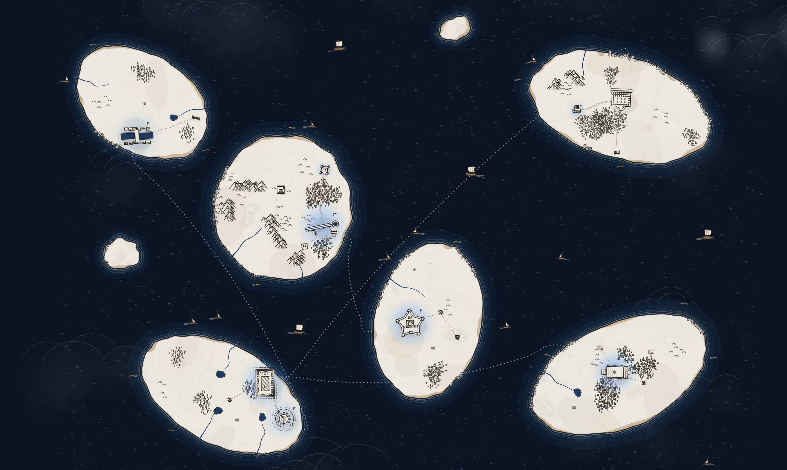

The atlas is a hand-engraved archipelago drawn in **midnight marble**: pale stone islands, charcoal ink, a deep navy sea and small touches of bronze. Each territory is its own island, each repository is a settlement on it, and the size, shape and condition of every settlement tells you something about the project it stands for. Electric blue appears only where something is alive or chosen.

---

## The palette

Seven families of colour make the whole world. Nothing else is ever used.

| | Name | Role |
|---|---|---|
|  | **Deep sea** · `#0a1422` | The open ocean and the frame around the map |
|  | **Sea** · `#14263b` | Coastal water, lakes and the depth bands near land |
| 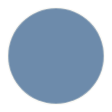 | **Wave** · `#6d8bab` | Engraved wave marks on open water |
| 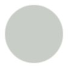 | **Shallows** · `#c9cdc8` | The pale rings that trace every shore |
|  | **Marble** · `#ebe7df` | The land itself |
| 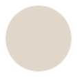 | **Warm marble** · `#e0d7c8` | Broad, sun-warmed patches across the stone |
| 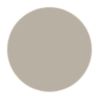 | **Marble shadow** · `#b8b0a3` | Ground shadows under buildings, trees and peaks |
| 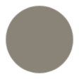 | **Vein** · `#8a8378` | Fine veins and cracks in the marble |
| 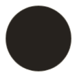 | **Ink** · `#26221e` | Every outline: coasts, buildings, mountains |
| 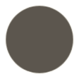 | **Soft ink** · `#5c564e` | Hatching, ruins and quieter linework |
| 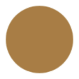 | **Bronze** · `#a87d45` | Pennants, roads, territory borders and ornament |
| 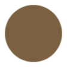 | **Dim bronze** · `#7b6141` | Secondary bronze detail |
|  | **Ivory** · `#f2ede2` | Sails, sea routes and the compass |
| 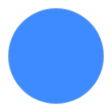 | **Active blue** · `#3d8bff` | Living systems, selection and focus — and nothing else |
| 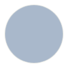 | **Fog** · `#a9b8cb` | Drifting cloud over the outer sea |

---

## The sea and its coasts

### Open water

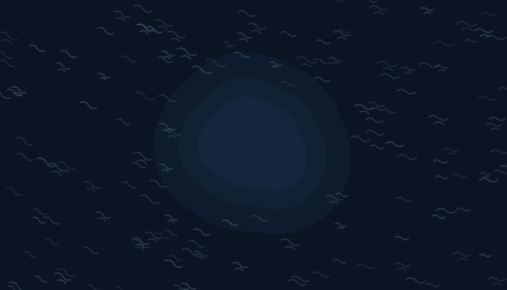

The sea darkens in stepped, engraved bands as it moves away from land, never as a smooth gradient. Short hand-cut wave marks drift across it, following an unseen current, and keep a respectful distance from every shore.

### Coastlines

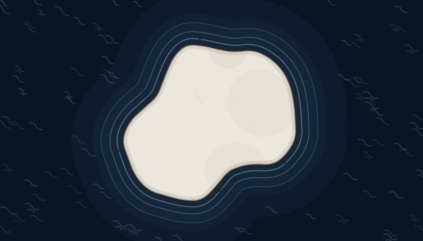

Every shore is an ink contour with a slight hand-drawn tremor, wrapped in three pale shallows rings that fade toward the deep. Small rocks sit off the sharpest headlands.

### Beaches

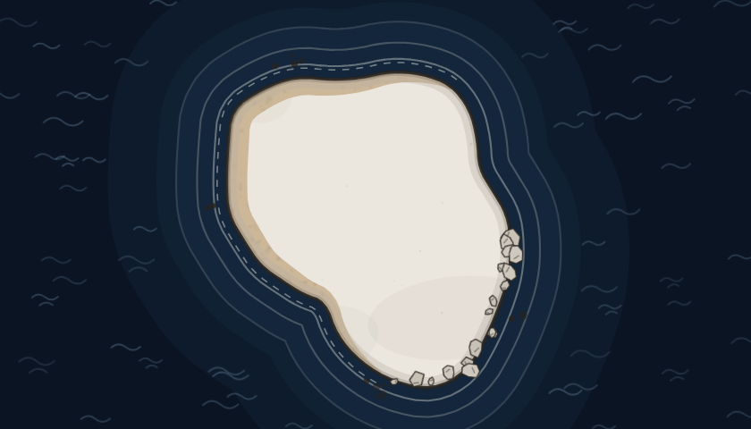

Coasts break into runs of **sand** — a warm band along the water's edge — and **rocky shores**, where boulders straddle the tide line.

### Islets

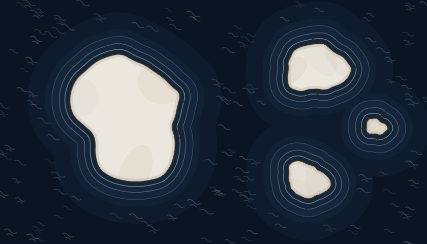

Small uninhabited islets gather in loose clusters a short sail from the larger islands. They belong to no territory.

### Ships

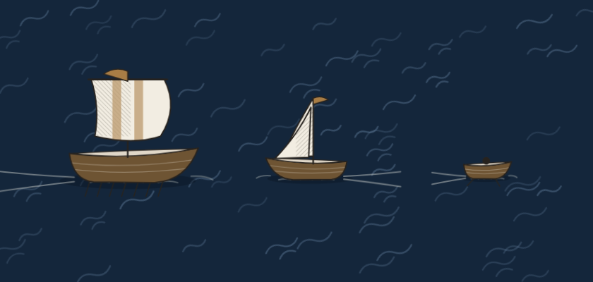

| Vessel | Where it sails |
|---|---|
| **Galley** | Oared, two-masted, on the open ocean |
| **Sailboat** | Single sail, in open water and along the coasts |
| **Rowboat** | Close to shore |

Ships are decoration: they carry no meaning, only life.

---

## The land

### Marble ground

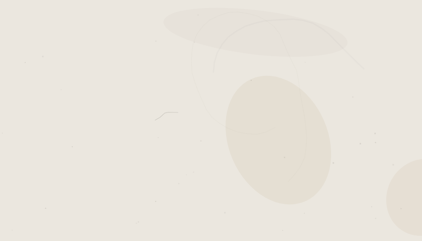

Land is pale marble with long branching veins, hairline cracks, patches of hatching and a light stipple. The texture never rises above a whisper, so buildings and names always read first.

### Mountains

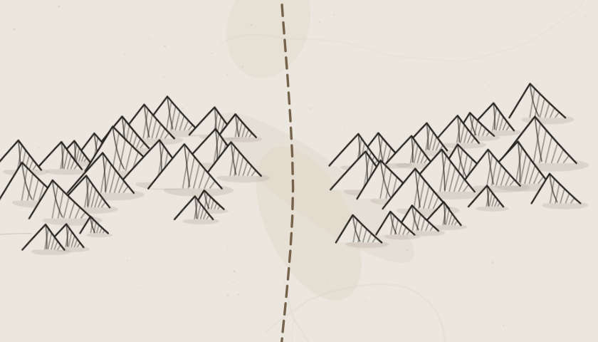

Ranges march along a ridge as asymmetric peaks: the west face left bright, the east face hatched in shadow. A **pass** is a gap in the range where a road can cross.

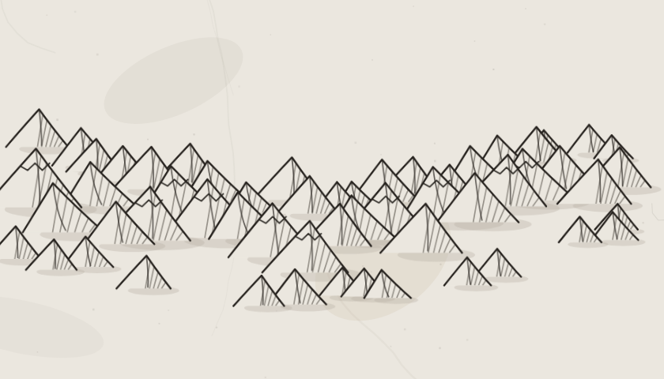

The highest ranges, in the mountainous territories, wear ragged **snowcaps**.

### Hills

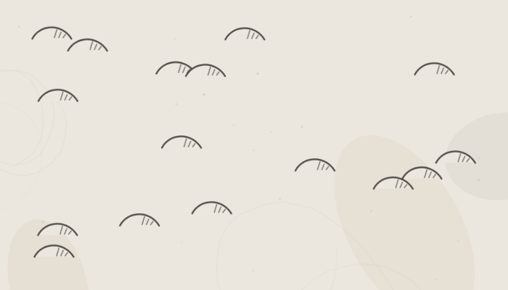

Low rounded arcs with a few hatch ticks fill the country between plains and peaks.

### Forests

| | Tree | Found in |
|---|---|---|
| 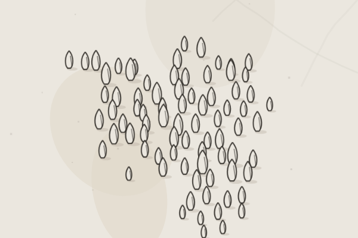 | **Cypress** — tall flame-shaped spires | AI & Agents, Web & Open Source |
| 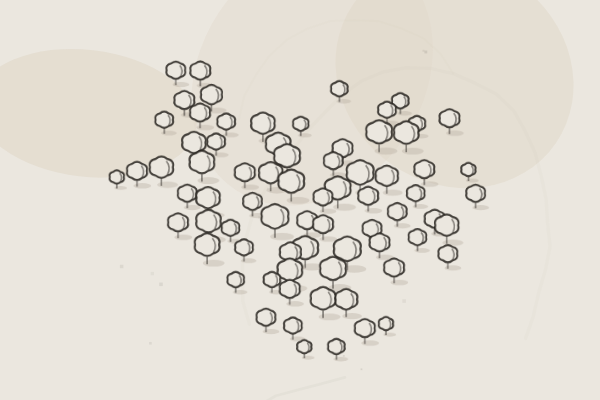 | **Olive** — round, lumpy crowns on short trunks | Backend & Security, Research Lab |
| 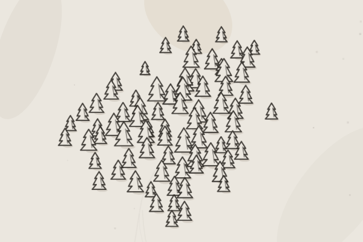 | **Pine** — stacked chevrons | Cloud & Distributed Systems, Experiments & Hackathons |

Forests thin out toward their edges, so they melt into the plain rather than ending in a line.

### Rivers and lakes

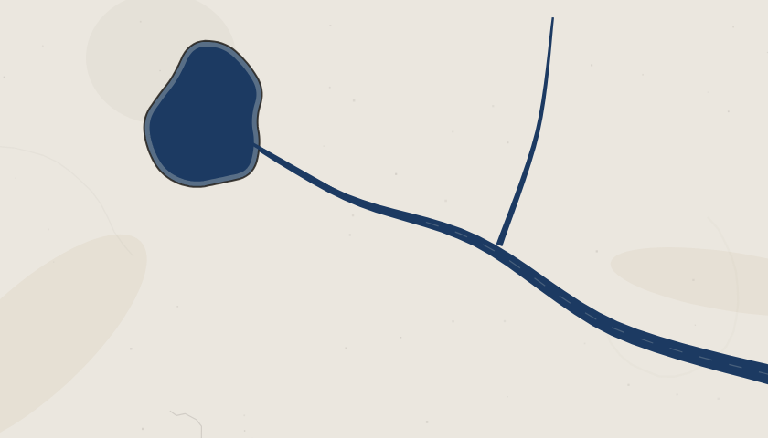

Rivers are muted blue ribbons that run narrow at their source and broaden toward the sea, gathering tributaries on the way. Some rise from a **lake**; lakes carry their own ink shore and shallows ring, and the water flows out of them without a seam.

### Territory borders

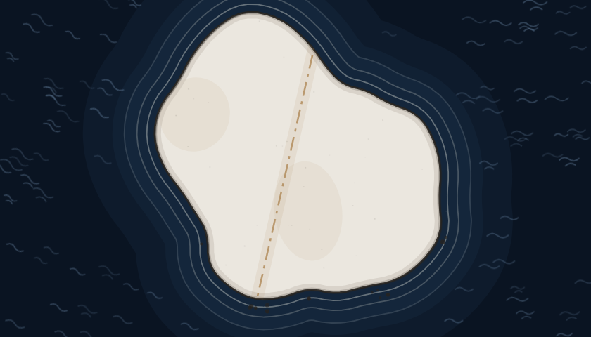

Where two territories share land, a dash-dot bronze line marks the frontier. Borders never run along a coast — the sea is border enough.

---

## The territories

Every repository belongs to one of six territories, and each territory is its own island with its own climate.

| Territory | Signature landmark | Country | Tree |
|---|---|---|---|
| **AI & Agents** | Observatory | A canal-laced lowland of observatories where autonomous systems watch the sky and each other. Waterways, plains, scattered forest. | Cypress |
| **Backend & Security** | Citadel | Orderly walled plains around a citadel; every road is checked at a gate. Plains and hills. | Olive |
| **Cloud & Distributed Systems** | Aqueduct complex | High ranges stitched together by aqueducts and bridges that carry load across every valley. Mountains, snowcaps, many rivers. | Pine |
| **Research Lab** | Academy | Cliff-bound headlands and an offshore academy where long questions are kept in quiet libraries. Cliffs, islands, groves. | Olive |
| **Web & Open Source** | Bridge city | Harbour towns of interfaces and forks, where work arrives from distant shores and leaves improved. Coasts, plains, waterways. | Cypress |
| **Experiments & Hackathons** | Forum | A broken archipelago of workshops, arenas and ruins, built fast and left to the weather. Islands, coast, marsh. | Pine |

---

## Settlements

Every repository is a settlement, drawn as a top-down plan: white stone, ink outline, a bronze accent. Its **kind** says what sort of project it is. Larger projects take the **major** form, drawn bigger and with more buildings.

| | Kind | What it stands for |
|---|---|---|
| 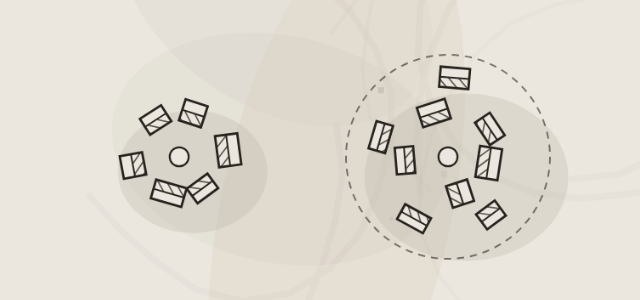 | **Village** — small houses around a plaza | A small utility or learning repository |
| 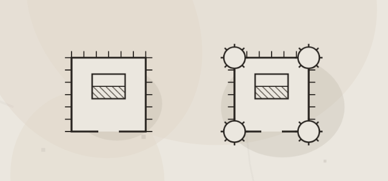 | **Outpost** — a palisade with one building | A small, focused backend or cloud project |
| 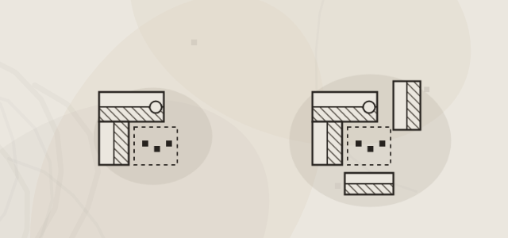 | **Workshop** — an L-shaped hall, yard and chimney | A prototype or experiment |
| 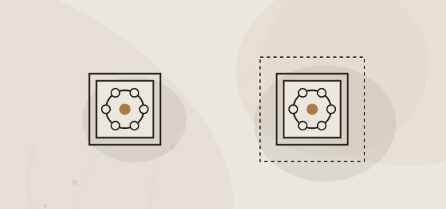 | **Shrine** — a small rotunda on a square base | A tiny special-interest project |
| 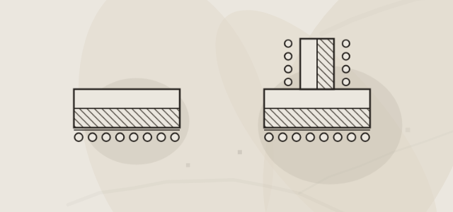 | **Archive** — a long hall with a colonnade | A maintained library, tooling or notes |
|  | **Port** — buildings and a pier reaching for the water | An open-source contribution or fork |
| 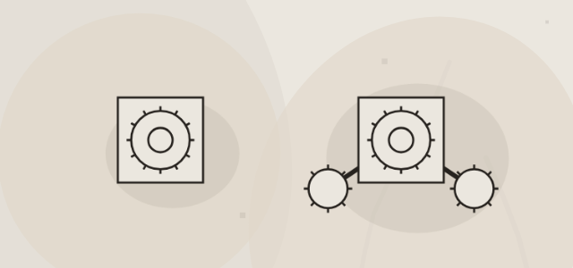 | **Tower** — a round keep inside crenellated walls | An infrastructure or security project |
| 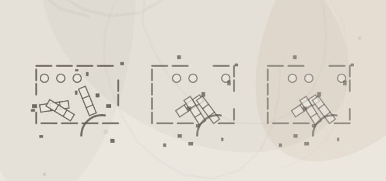 | **Ruin** — broken foundations and toppled columns, more weathered with age | An archived or long-untouched repository |

Each pair above shows the minor form on the left and the major form on the right; the ruins show three degrees of weathering.

---

## Landmarks

The most important project in each territory rises as that territory's **landmark** — a monument rather than a town. The single most important project in the whole world becomes the **Temple**.

| | Landmark | What it stands for |
|---|---|---|
| 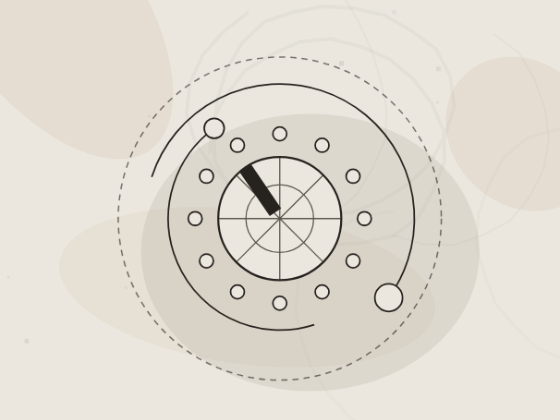 | **Observatory** — a domed hall with a meridian slit, ringed plaza and orrery arcs | The leading AI & agents project |
| 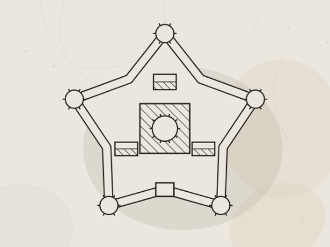 | **Citadel** — a star fort with bastions, an inner keep and a gate | The leading backend & security project |
| 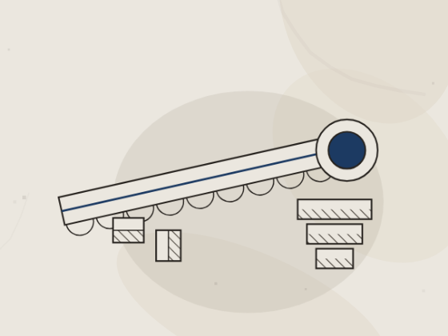 | **Aqueduct complex** — an arched channel feeding a water tower and terraces | The leading cloud & distributed-systems project |
| 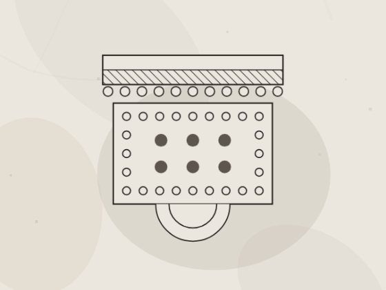 | **Academy** — a colonnaded courtyard with a stoa | The leading research project |
| 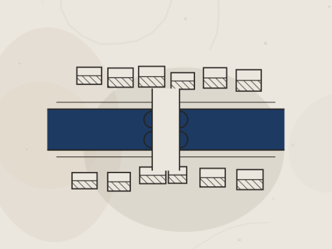 | **Bridge city** — a town spanning a river on a long bridge, with quays | The leading open-source project |
| 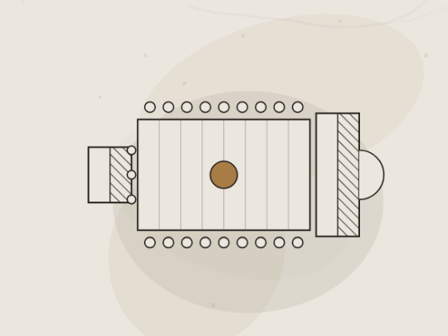 | **Forum** — a rectangular square with a basilica | The leading experiment |
| 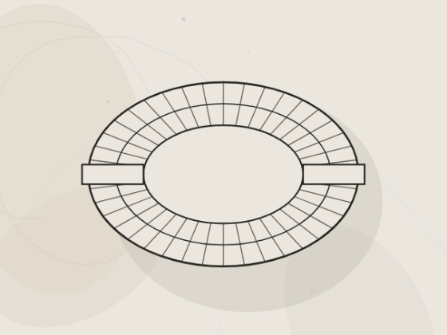 | **Arena** — an elliptical amphitheatre with radial seating | A hackathon showcase |
|  | **Library** — a long hall with an apse and a reading court | A documentation or knowledge system |
| 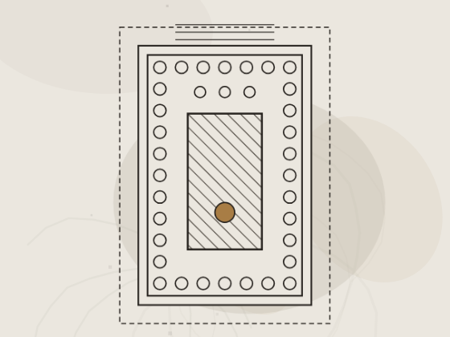 | **Temple** — a colonnaded temple within its sacred precinct | The flagship of the entire world |

### Standing and size

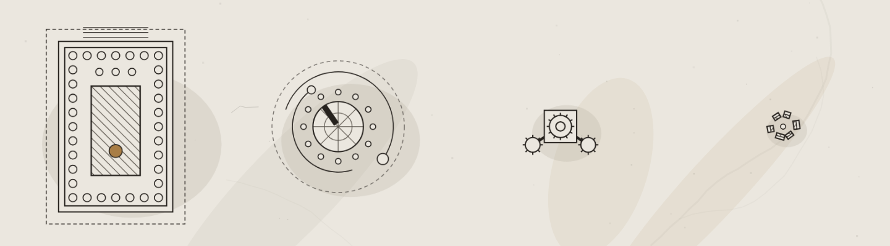

From left to right: the **Temple**, a territory **landmark**, a **major** settlement and a **minor** one. A project's standing comes from its impact, its recent activity, whether it is live, and the attention it has earned.

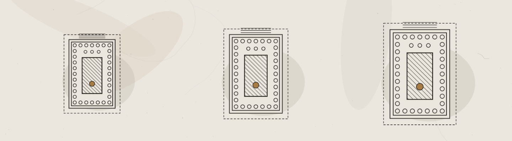

Landmarks grow with their project's impact.

---

## Signs of life

### Status

| | Status | How it reads |
|---|---|---|
| 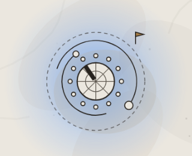 | **Deployed** | Running somewhere you can visit. A bronze pennant flies and a full blue glow rises beneath it. |
| 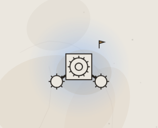 | **Active** | Worked on recently. A pennant and a softer glow. |
| 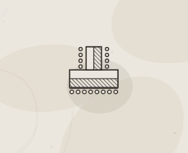 | **Maintained** | Stable and cared for. Plain stone, no glow. |
| 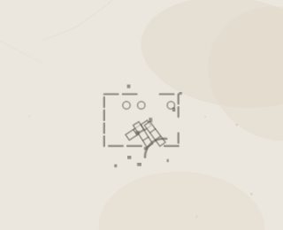 | **Archived** | Retired. The settlement has fallen into ruin; it never glows. |

### The glow

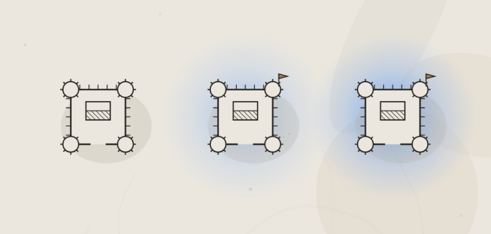

Blue light under a settlement means it is alive: none for maintained work, a soft halo for active projects, a full glow for deployed ones.

### Hover, selection and focus

| | State | Meaning |
|---|---|---|
|  | **At rest** | The settlement as drawn |
|  | **Hovered** | Outlines thicken under the pointer |
|  | **Selected** | A solid blue ring with four ticks; its roads light up |
|  | **Focused** | A dashed ink ring around a blue one, for keyboard travel |
|  | **Filtered out** | Faded to grey; still there, still reachable |
|  | **Found** | Expanding blue rings when you arrive from a search |

---

## Connections

### Roads

Roads join related settlements on the same island. A **footpath** is a single dashed bronze line; a **major road**, between important places, is doubled and set with milestones.

### Bridges

| | Bridge | Where it stands |
|---|---|---|
|  | **Stone bridge** — two parapets and an arch | The ordinary river crossing |
|  | **Aqueduct** — a ladder of arched piers | River crossings in Cloud & Distributed Systems |
|  | **Long arched bridge** — many piers under a broad deck | The widest rivers |

### Sea routes

Projects on different islands that belong together are joined by a **sea route**: a dotted ivory line arcing across the water.

When either end is hovered or selected, the route turns blue and a light runs along it.

### The selection thread

A selected settlement casts a blue thread along every road that touches it, so its neighbours are easy to find.

---

## Ornaments

### Compass rose

An engraved sixteen-point rose in ivory and bronze keeps its corner of the map at every zoom.

### The statue

|  |  |  |  |
|---|---|---|---|
| **Architect** | **Scroll** | **Compass** | **Atlas** |

One classical statue stands near the centre of the largest island — a single monument to the cartographer.

### Fog and cloud

Soft cloud drifts slowly over the outer sea. It parts around whatever you are looking at.

---

## Reading the map

| Distance | What you see |
|---|---|
| **Far** | Islands, coasts, territory names, landmarks and major settlements |
| **Middle** | Every settlement, forests, rivers, roads and the glow of living projects |
| **Near** | Settlement names, bridges, the full grain of the marble |

Names are never painted into the map: territory and settlement names float above it, and every settlement can also be reached from the repository list.
